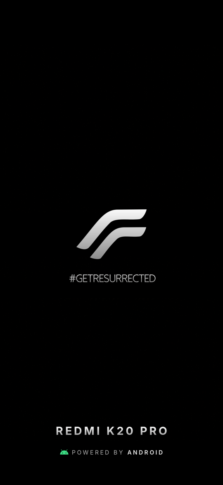

# Redmi K20 Pro Bootsplash — Resurrection Remix

Custom boot logo for the **Redmi K20 Pro / Mi 9T Pro (`raphael`)**, flashable from TWRP / OrangeFox.

<p align="center"></p>

- Resurrection Remix "double swoosh" logo with `#GETRESURRECTED`
- **REDMI K20 PRO** and **POWERED BY ANDROID** at the bottom
- Shown on normal boot **and** on unlocked-bootloader boot (no "unlocked" warning screen)
- Fastboot and "system destroyed" screens stay stock

> ⚠️ **Only for raphael.** The installer refuses to flash on any other device.

## Install

1. Build or download `RRSplash-raphael.zip` (see below).
2. Boot into TWRP / OrangeFox and flash the zip.
3. Reboot.

The installer:

1. checks that the device is `raphael`
2. finds the `logo` partition (`/dev/block/by-name/logo` or `/dev/block/bootdevice/by-name/logo`)
3. checks the image fits the partition
4. backs up your current logo to `/sdcard/logo_backup.img` (once; never overwrites an existing backup)
5. writes the new logo and reads it back to verify

### Restore stock

```sh
fastboot flash logo logo_backup.img
```

or flash `logo.img` from the official MIUI fastboot ROM.

## Build

Requirements: `python3` with Pillow, `zip`, and the [Inter](https://rsms.me/inter/) font
(set `FONT_DIR` if it is not in `/usr/share/fonts/opentype/inter`).

```sh
./build.sh            # -> out/RRSplash-raphael.zip
```

You can also zip it by hand: `zip -r RRSplash-raphael.zip META-INF cache`.

## Repository layout

| Path | Contents |
|---|---|
| `META-INF/com/google/android/update-binary` | Installer: shell script with busybox attached (from topjohnwu's Magisk) |
| `META-INF/com/google/android/updater-script` | Install logic (device check, backup, flash, verify) |
| `cache/logo.img` | Ready-to-flash `logo` partition image |
| `assets/source.png` | Original artwork (`#GETRESURRECTED`) |
| `assets/rr_swoosh.svg` | Resurrection Remix logo (from Simple Icons) |
| `assets/rr_swoosh_mask.png` | The SVG rendered to 1200×1200 (`tools/render_svg.js`) |
| `assets/boot_logo_1080x2340.png` | Final boot picture |
| `tools/make.py` | Composes the 1080×2340 boot picture |
| `tools/pack.py` | Writes the picture into slots 1 and 3 of `logo.img` |
| `tools/render_svg.js` | Renders the SVG with Playwright/Chromium |

## `logo.img` format

Xiaomi `LOGO!!!!` format: zeros up to `0x4000`, then the magic `LOGO!!!!` followed by
(offset, length) pairs counted in 4 KiB blocks. Each slot holds an uncompressed 24-bit BMP.

| Slot | Offset | Size | Screen |
|---|---|---|---|
| 1 | `0x5000` | 1080×2340 | Boot logo |
| 2 | `0x740000` | 1080×1920 | Fastboot (stock) |
| 3 | `0xD2F000` | 1080×2340 | Boot logo, unlocked bootloader |
| 4 | `0x146A000` | 1080×1920 | "The system has been destroyed" (stock) |

## Credits

- Resurrection Remix logo: Resurrection Remix OS, via [Simple Icons](https://simpleicons.org/). No license is
  stated for this icon; it belongs to the Resurrection Remix project.
- The Android robot is reproduced or modified from work created and shared by Google and used according
  to terms described in the [Creative Commons 3.0 Attribution License](https://creativecommons.org/licenses/by/3.0/).
  Android is a trademark of Google LLC.
- Installer `update-binary` and busybox: topjohnwu (Magisk).
- Based on the original EvoSplash zip for raphael.
